# Sector Pulse: jobs, stock returns, careers and live job postings by sector, California and the U.S. (2021–2026)

**Which industries are hiring, which are shrinking, which ones did investors reward, and which occupations and college majors do the numbers favor?**

This project puts five views of the same sectors side by side:

1. **Jobs**: five years of official payroll data for California and the whole United States (U.S. Bureau of Labor Statistics).
2. **Stock market**: five-year and one-year total returns and momentum for the 11 S&P 500 sector funds.
3. **The last three months**: a small dataset I collected by hand from primary reports (BLS JOLTS job openings and the Challenger, Gray & Christmas job-cut reports), with a source link for every table.

4. **Careers and college majors**: the five occupations with the most yearly openings in engineering, health care, finance, computer & data and film & media (BLS projections 2025–35), and early-career outcomes for 73 college majors (Federal Reserve Bank of New York).
5. **Live job postings**: a one-day snapshot (17 Nov 2026) of **39,215 open postings** collected from the public job APIs behind 283 employers' careers pages (Greenhouse, Ashby, Lever, SmartRecruiters) and three remote job boards (Remotive, Remote OK, Jobicy), sorted into job families, seniority levels and locations, with the skills and pay named in data-related postings.

Python cleans the files and loads them into one SQLite database. The analysis is 43 SQL queries, and the results feed static charts and an interactive dashboard.

📊 **Interactive dashboard:** https://resulisik.github.io/california-jobs-by-sector/

---

## Key findings

| | |
|---|---|
| **1. Health care carried California** | Since Sep 2021 California added **+1.18M jobs (+7.0%)**. Health care & social assistance accounted for **+728K of them (61%)**, and for **81%** of the last 12 months' growth. |
| **2. Outside health care, California trails the country** | The U.S. grew **+7.7%** over the same five years. California is behind in **8 of 11 sectors**. The widest gaps are construction (+0.6% vs +11.8%) and financial activities (−6.1% vs +2.6%). |
| **3. Tech and media jobs are shrinking everywhere** | Information jobs fell **−12.5%** in California and **−6.2%** nationally. California's share of U.S. information jobs slipped from 19.8% to 18.5%. |
| **4. Stock returns and jobs tell different stories** | Technology stocks returned **+131%** in five years while U.S. tech and media jobs fell **−6.9%**. Health care is the reverse: the fastest job growth (**+17.9%**) but a **+50%** return, below the S&P 500's **+76%**. |
| **5. Market leadership rotated in the last 12 months** | Energy (**+63%**), health care (**+30%**) and materials (**+25%**) led. Technology slowed from +36% to +20%, and communication services turned negative (**−12%**). |
| **6. U.S. hiring picked up in the last three months** | Payrolls rose **+411K** from July to October 2026, against about +85K per three months in the year before. Professional & business services added **+108K**; information lost 33K. |
| **7. Layoff announcements are low, except in tech** | Employers announced **140K** job cuts in Aug–Oct 2026. Year to date they are **−44%** on 2025, but technology is **+21%** and accounts for 28% of all cuts this year. |
| **8. Job openings moved toward goods and logistics** | Openings in Sep 2026 were up **+50%** on a year earlier in manufacturing and **+45%** in construction, and down **−32%** in leisure & hospitality. |

### Careers and college majors

| | |
|---|---|
| **9. The openings are in nursing, accounting and software** | BLS projects **181K** openings a year for registered nurses, **115K** for accountants and auditors and **95K** for software developers. Among bachelor's-level jobs, data scientists grow fastest (**+34.6%** by 2035); computer programmers shrink most (−7.3%). |
| **10. Top five by field** | **Engineering:** industrial, civil, mechanical, electrical, other engineers. **Health care:** registered nurses, licensed practical nurses, pharmacy technicians, nurse practitioners, clinical lab technologists. **Finance:** accountants, financial managers, financial analysts, personal financial advisors, loan officers. **Computer & data:** software developers, user support specialists, systems analysts, other computer occupations, data scientists. **Film & media:** art directors, producers and directors, writers, audio and video technicians, actors. |
| **11. The major matters as much as the degree** | Underemployment (recent graduates in jobs that do not need a degree) runs from **12.8%** in nursing to **65.8%** in criminal justice, against 39.4% for all graduates. Only **10 of 73** majors beat the average graduate on unemployment, underemployment and early pay together: accounting, finance, economics, nursing, construction services, physical sciences and four engineering majors. |
| **12. High pay does not mean an easy start** | Computer engineering ($90K early-career pay) and computer science ($87K) have **7.8%** and **7.0%** unemployment, against 4.2% for all graduates. |

These are averages for past graduates and ten-year projections. They describe groups, not what will happen to one person.

### Live job postings (one-day snapshot, 17 Nov 2026)

| | |
|---|---|
| **13. What employers are posting** | Of **29,153** U.S. postings, operations & service (**20.8%**), software engineering & IT (**17.4%**) and hardware & other engineering (**16.4%**) lead. AI & machine learning is 5.9%; data & analytics is **2.3%** (659 postings), and 47% of those are in California. |
| **14. Junior roles are scarce** | Only **10.2%** of U.S. postings are entry level or internships. In software engineering it is **5.1%** and in data & analytics **7.0%**; operations (19.9%) and clinical health care (16.0%) are the most open to beginners. Most postings (68.6% in data) ask for senior people. |
| **15. SQL and Python come first** | Of 653 U.S. data & analytics postings whose description was read, **77%** name SQL and **72%** Python, then statistics (46%) and A/B testing (30%). Tableau (21%) leads the BI tools; Excel (13%) and Power BI (9%) trail. The median advertised pay is **$181K** where no level is stated (126 postings); only 3 entry-level data postings state pay. |
| **16. Top titles by sector** | **Health care:** psychiatrist, prescribing nurse practitioner or physician assistant, software engineer, mental health therapist, account partner. **Finance:** software engineer, account executive, engineering manager, product designer, data scientist. **Media & gaming:** software engineer, machine learning engineer, data scientist, editor, software engineering manager. **Aerospace:** software, manufacturing, mechanical, electrical and systems engineers. Across all engineering postings: software (3,911), manufacturing/quality/test (864), mechanical (687), machine learning (647), electrical (577). |
| **17. Los Angeles postings are an aerospace story** | **80%** of the 4,470 Los Angeles-area postings come from aerospace, defense & hardware employers; Anduril and SpaceX alone post 55%. |

The snapshot is a sample of the market, not a census: it covers employers whose hiring systems publish an open API, which leans toward tech, aerospace and startups (California holds 45% of the U.S. postings). Hospitals, studios, banks and governments mostly use systems without one.

**What I take from it:** for an entry-level analyst, the steadiest demand is in health care (hospitals, insurers, public agencies), with professional & business services recovering nationally. California job postings sit at 87 against 104 nationally (Feb 2020 = 100), so the search should include remote roles outside the state. Live postings add two things: about one posting in ten is open to beginners, so postings with no level stated are worth applying to; and SQL plus Python appear in three of every four data postings, more than any BI tool.

The stock figures describe past returns. Nothing here is investment advice.

## Charts

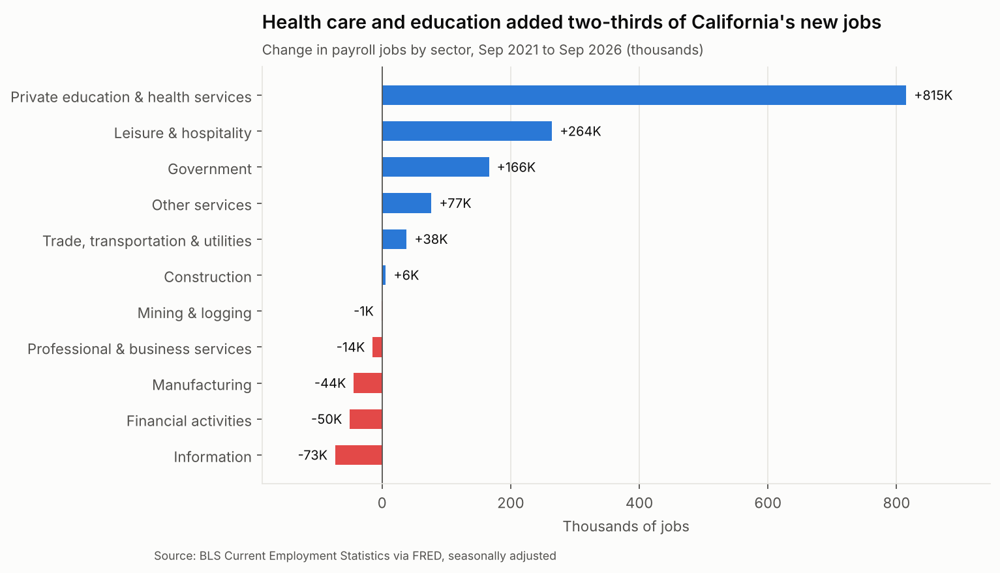
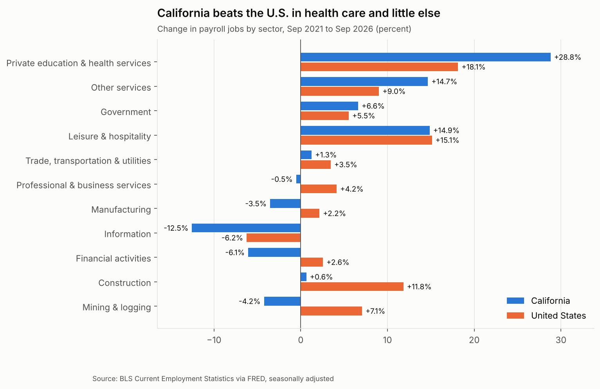
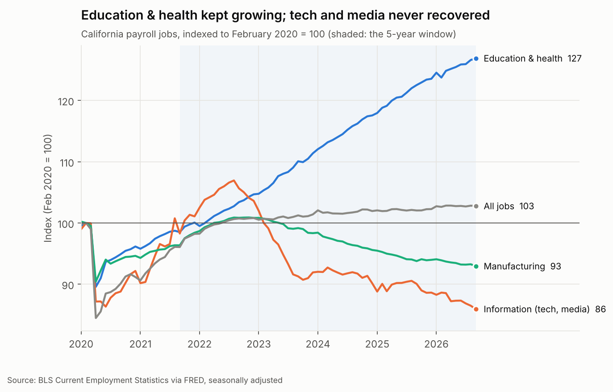
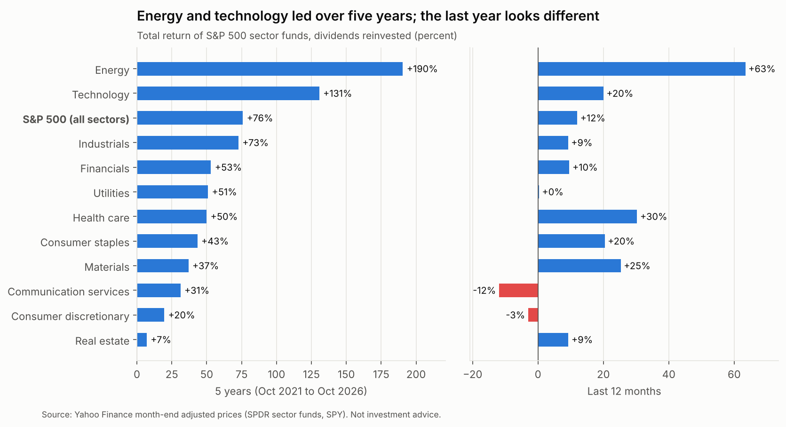
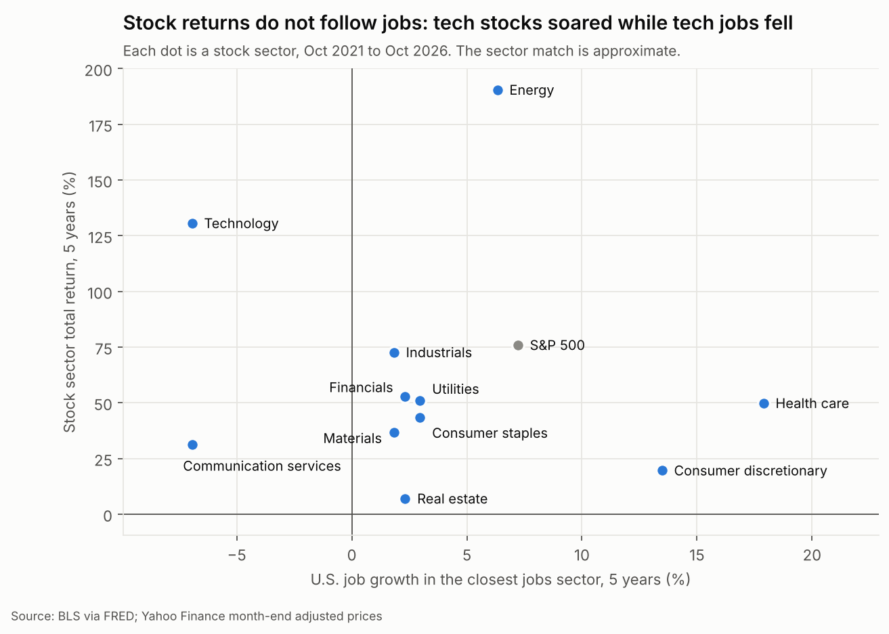
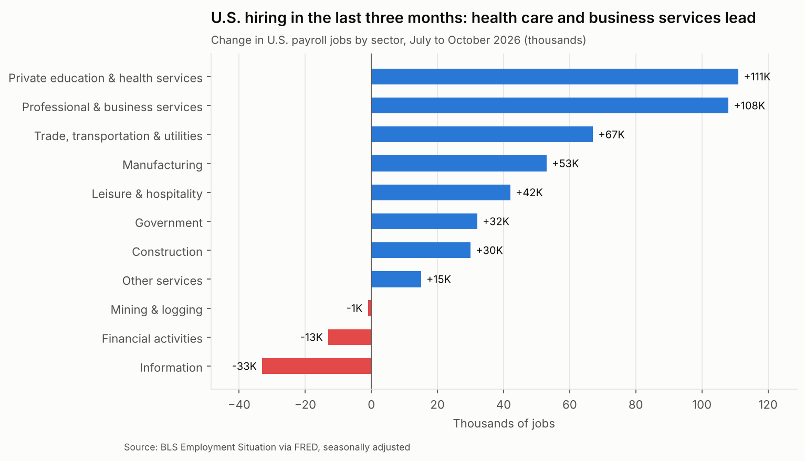
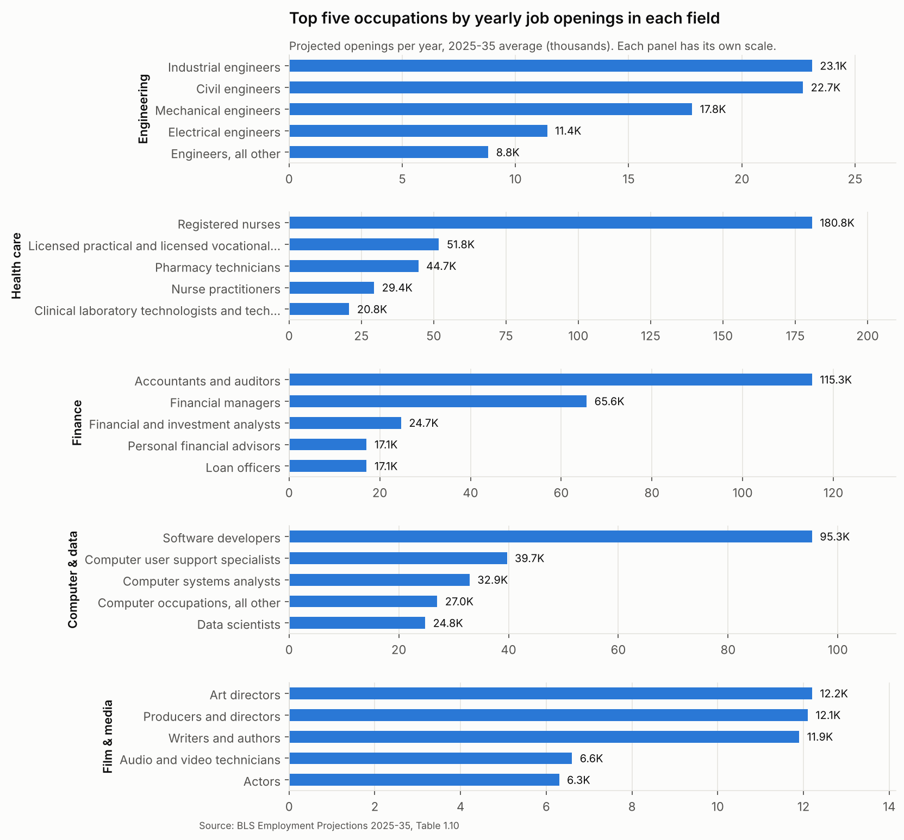
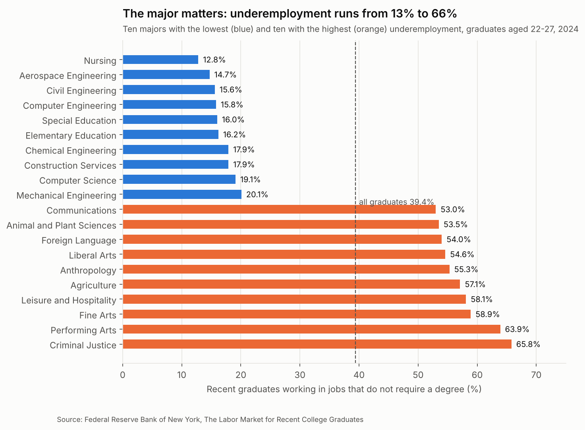
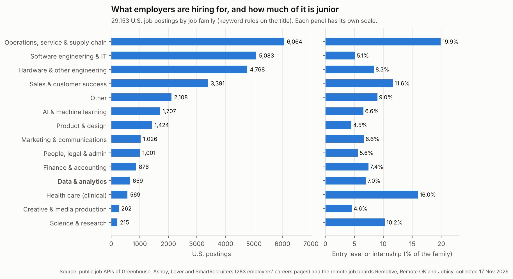
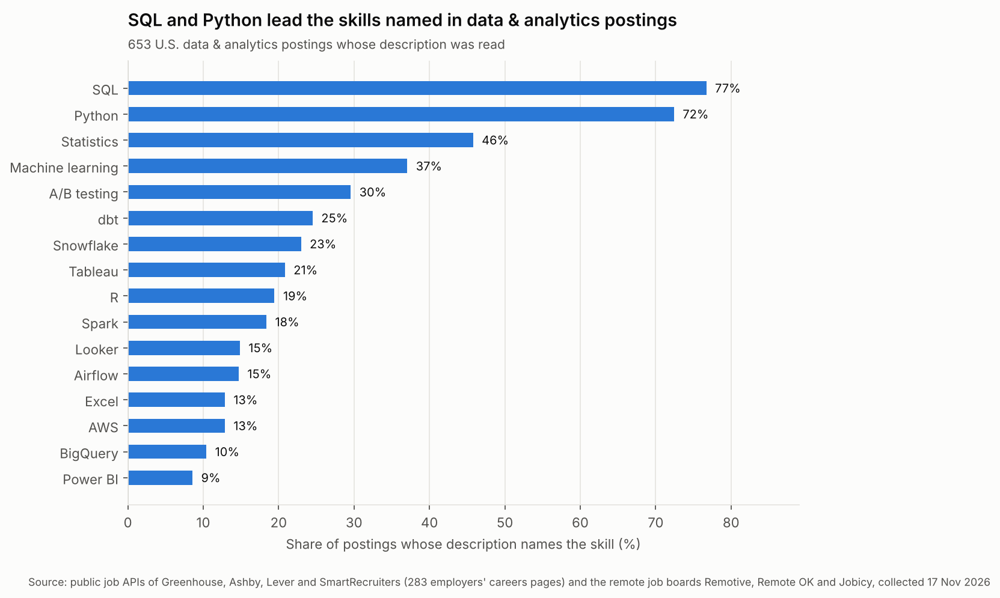
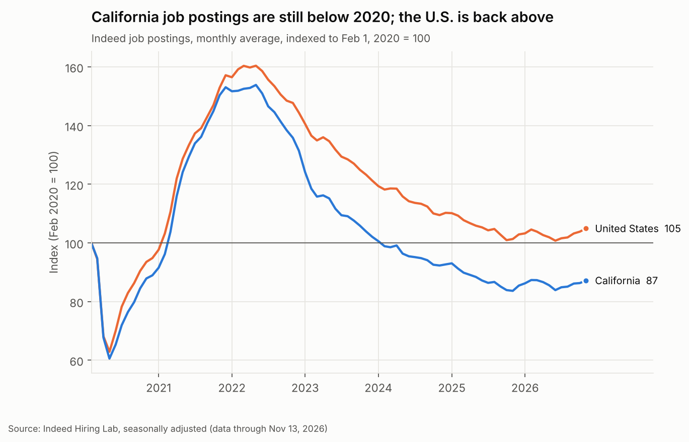
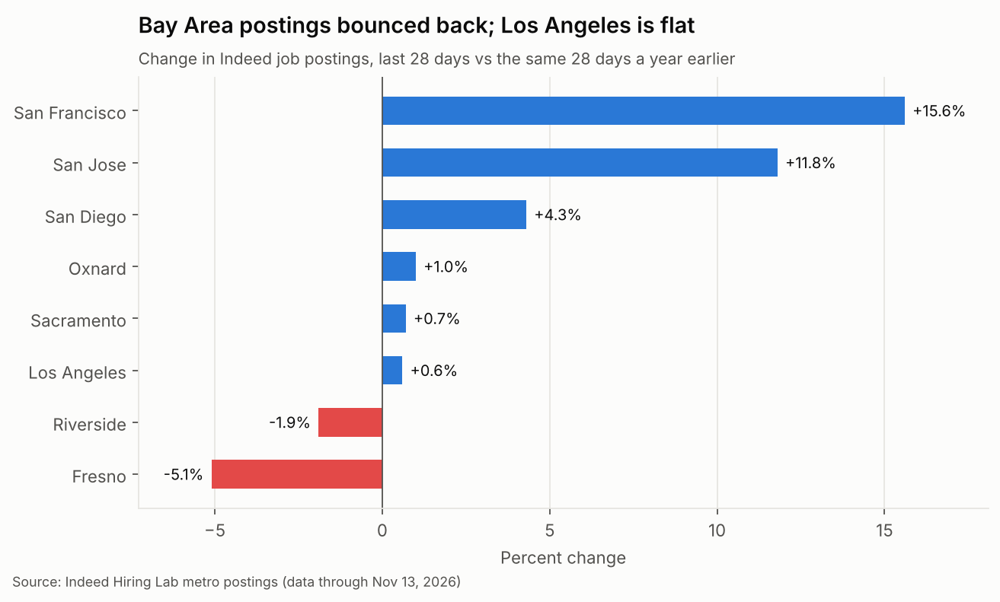
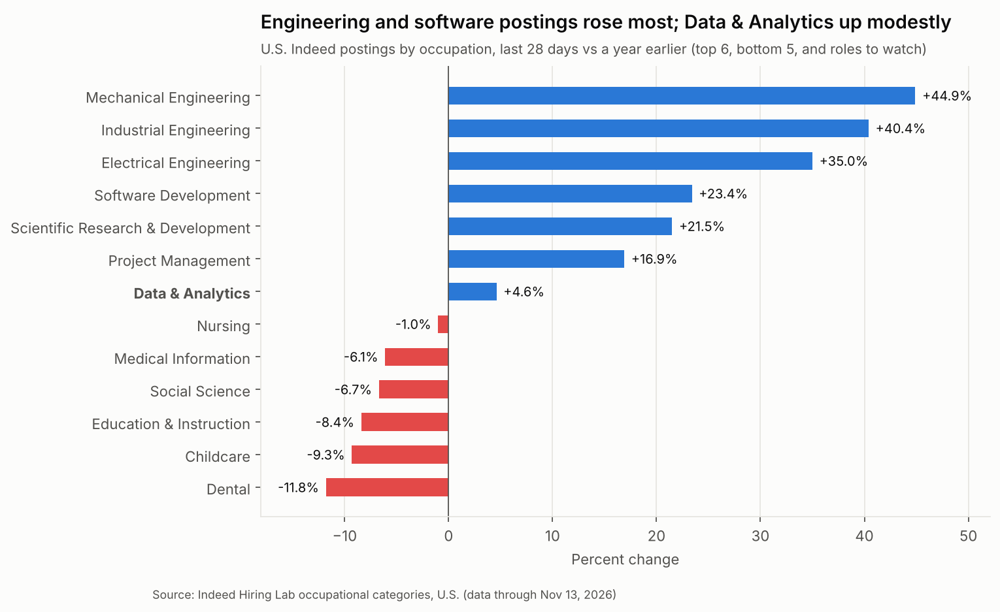

## Data

| Source | What | Frequency | Coverage |
|---|---|---|---|
| BLS Current Employment Statistics, via [FRED](https://fred.stlouisfed.org/) | Payroll jobs: California (total, 11 sectors, 8 industries, Los Angeles County) and the U.S. (total, 11 sectors, health care) | Monthly | Jan 2020 – Sep 2026 (California), Oct 2026 (U.S.) |
| Yahoo Finance | Month-end adjusted close (dividends reinvested) of the 11 SPDR Select Sector funds and SPY | Monthly | Dec 2020 – Oct 2026 |
| [Indeed Hiring Lab](https://github.com/hiring-lab/job_postings_tracker) | Job postings index: California, U.S., 30 California metros, 47 occupations | Daily | Feb 2020 – Nov 6, 2026 |
| **Hand-collected** ([`data/research/`](data/research)) | BLS JOLTS Table A (openings, hires, separations by industry); Challenger job-cut reports (cuts by industry, reasons, hiring plans) | Monthly | Aug – Oct 2026 |
| **Hand-collected** ([`data/research/`](data/research)) | BLS Employment Projections Table 1.10: 64 occupations (top 8 by openings in five fields, plus the fastest and slowest growing bachelor's-level occupations) | 10-year projection | 2025 – 2035 |
| **Hand-collected** ([`data/research/`](data/research)) | New York Fed outcomes by college major: unemployment, underemployment, early and mid-career pay, graduate-degree share for 73 majors | Annual | 2024 |
| **Collected** ([`data/raw/postings/`](data/raw/postings)) | 39,215 open job postings: title, department, location, date and link, plus the skills and pay range named in 3,171 data-related descriptions. Public APIs of [Greenhouse](https://developers.greenhouse.io/job-board.html), [Ashby](https://developers.ashbyhq.com/docs/public-job-posting-api), [Lever](https://github.com/lever/postings-api) and [SmartRecruiters](https://developers.smartrecruiters.com/docs/posting-api) for 283 employers (listed in [`postings_boards.csv`](data/research/postings_boards.csv)), and the remote job boards [Remotive](https://remotive.com), [Remote OK](https://remoteok.com) and [Jobicy](https://jobicy.com) | One-day snapshot | 17 Nov 2026 |

**Why not LinkedIn, Indeed, ZipRecruiter or Glassdoor?** Their terms of use forbid automated collection and they offer no open postings API, so they are not scraped here. The Indeed figures above come from Indeed's own published dataset. USAJOBS (federal jobs) has an official API that needs a free key; it can be added to `collect_postings.py`. Postings from Remotive and Remote OK are credited to them and every posting keeps its link back to the original.

Every hand-collected table has its report and link in [`data/research/sources.csv`](data/research/sources.csv). All series IDs and tickers are in [`src/config.py`](src/config.py).

Three groupings in this project are my own judgment and are approximate: Challenger industries to BLS jobs sectors (in `challenger_job_cuts.csv`), stock sectors to the closest jobs sector, and college majors to eight families (both in `src/config.py`). The film & media field is a list of 12 occupations I chose. Stock sectors group companies by what they sell; jobs sectors group employers by what they do.

## How it works

```
download_data.py ──► data/raw/            FRED, Yahoo Finance and Indeed files
(by hand) ─────────► data/research/       JOLTS, Challenger, BLS projections and NY Fed tables with sources
collect_postings.py► data/raw/postings/   one-day snapshot from public job APIs
build_database.py ─► data/sectors.db      19 tables (postings classified by src/postings.py)
validate.py ───────► checks vs published  EDD, BLS, Challenger and JOLTS headline numbers
run_queries.py ────► sql/results.md       43 SQL questions
make_charts.py ────► charts/*.png
build_dashboard.py ► docs/index.html      self-contained interactive page (no external libraries)
```

## SQL analysis

[`sql/analysis_queries.sql`](sql/analysis_queries.sql) answers 43 questions. The output is in [`sql/results.md`](sql/results.md).

| Part | Questions |
|---|---|
| California jobs (Q1–Q12) | Five-year and 12-month change by sector, recovery against Feb 2020, sector shares, health care's share of growth, industry spotlight, losing streaks, postings by state, metro and occupation, Los Angeles County |
| California vs U.S. (Q13–Q15) | Growth gap by sector, California's share of U.S. jobs, job momentum (last 12 months vs the 12 before) |
| Stock sectors (Q16–Q20) | Returns over 5 years, 1 year, 6 and 3 months; momentum vs the S&P 500; year-by-year returns; maximum drawdown; stock returns vs job growth |
| Last three months (Q21–Q24) | Payroll change vs the earlier pace, announced layoffs by sector, openings per hire, and a sector scorecard that joins all four sources |
| Careers and majors (Q25–Q30) | Top five occupations by openings in each field, fastest growing and shrinking bachelor's-level jobs, majors by underemployment, major families compared, a three-test major scorecard, well-paid majors with high unemployment |
| Live job postings (Q31–Q43) | What each platform returned, job families and their junior share, top five families and titles in each sector, engineering postings by kind, location by family, junior share by sector, data roles by sector and level, skills in data postings, advertised pay, top Los Angeles employers, freshness, and a list of open analyst roles with links |

**Techniques:** CTEs; window functions (`LAG`, `RANK`, `ROW_NUMBER`, running `MAX` and `AVG` with frames, named windows); conditional aggregation with `CASE` to pivot months into columns; self-joins; scalar subqueries; `LEFT JOIN` across sources; date arithmetic for rolling 28-day windows.

[`sql/practice_queries.sql`](sql/practice_queries.sql) is a shorter file that walks from `SELECT` to window functions on the same database.

## Validation

`python src/validate.py` compares the database with published figures and stops on any mismatch:

- California's 12-month change in all 11 sectors matches the state's (EDD) September 2026 release to the job.
- U.S. October 2026 changes match the BLS Employment Situation release (total +165,000; professional & business services +70,000; manufacturing +19,000).
- The hand-collected monthly layoff totals match the published headlines (52,881; 43,281; 43,994), and the JOLTS sectors add up to the published total.
- Spot checks on the occupation and majors tables (registered nurses' openings, the all-graduates row, 74 unique rows).
- Every jobs and price series has all its months with no gaps.
- Job postings: unique IDs, platform totals add up, every posting has a family, level and location, and the classification rules pass their tests (`tests/test_postings.py`).

## Run it yourself

```bash
pip install -r requirements.txt
python src/download_data.py     # about 80 MB; skips files that already exist
python src/build_database.py
python src/validate.py
python src/run_queries.py
python src/make_charts.py
python src/build_dashboard.py   # writes docs/index.html
python src/collect_postings.py  # optional: a new postings snapshot (then set POSTINGS_SNAPSHOT in src/config.py)
```

The committed postings snapshot was collected from a browser with the same API requests that `collect_postings.py` makes.

The BLS, stock and hand-collected files are committed. Only the large Indeed files need the download step.

To explore without Python: build the database once, open `data/sectors.db` in [DB Browser for SQLite](https://sqlitebrowser.org/), and paste queries from the `sql/` folder into the **Execute SQL** tab.

## Limitations

- Payroll data counts jobs by the **employer's industry**, not by occupation. A data analyst at a hospital counts as a health care job.
- Sector funds hold large listed companies. They do not represent every employer in a sector, and returns use month-end prices, so drawdowns inside a month are not visible.
- Challenger counts **announced** job cuts, not actual layoffs, and my 22 industries cover 90–98% of each month's total. JOLTS September 2026 figures are preliminary.
- The occupation table holds 64 of 831 detailed occupations, selected as described above, so it cannot answer questions about other fields. Projections are estimates and are revised every year.
- Major outcomes come from a survey of people who already graduated; they mix the effect of the major with who chooses it.
- The Indeed index measures the **trend** in postings relative to Feb 1, 2020, not the number of open jobs.
- BLS revises data. Figures here are as published in early November 2026.
- The postings snapshot covers one day and the employers whose hiring systems have an open API, so it leans toward tech, aerospace and startups, and toward California. Job family, seniority and location come from keyword rules on the title and location text (about right, not exact). "Mid or not stated" includes every posting without a level word. Greenhouse reports the last update date for some postings, so "posted" can be later than the first posting date. Skills are matched by keyword in descriptions, and pay is the first range a posting states.

## Project structure

```
├── charts/                 PNG charts used above
├── dashboard/template.html dashboard template (data is injected at build time)
├── data/
│   ├── raw/bls/            BLS series from FRED (committed)
│   ├── raw/stocks/         sector fund prices (committed)
│   ├── raw/indeed/         Indeed files (downloaded, not committed)
│   ├── raw/postings/       job postings snapshot (committed)
│   ├── research/           hand-collected tables and their sources
│   └── processed/          tidy CSV extracts
├── docs/index.html         built dashboard (GitHub Pages)
├── sql/                    analysis queries, results, practice queries
├── src/                    Python pipeline
└── tests/                  tests for the postings classification rules
```

---

**Resul Isik** · Data Analyst · Los Angeles, CA · [LinkedIn](https://www.linkedin.com/in/resul-isik/) · [GitHub](https://github.com/resulisik)
