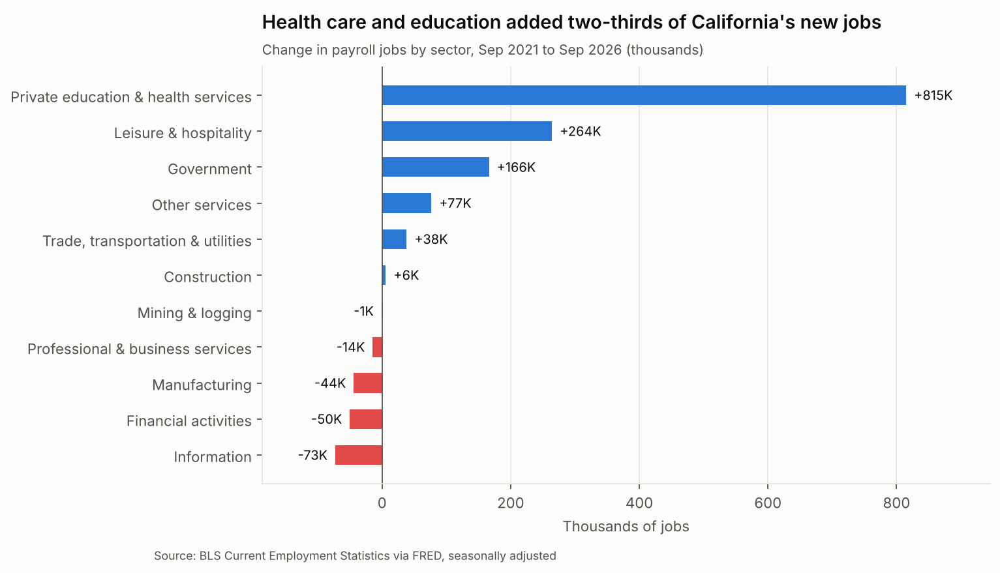
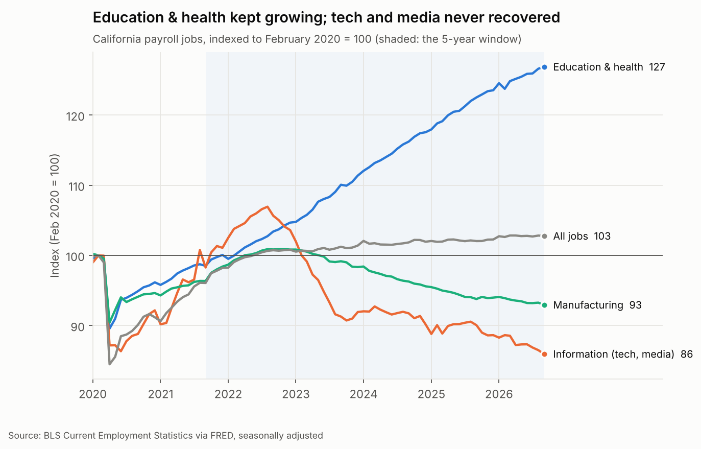
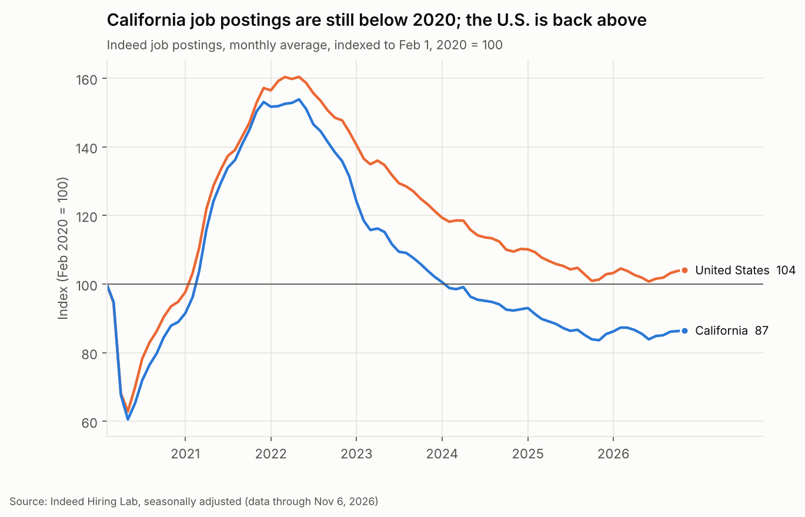
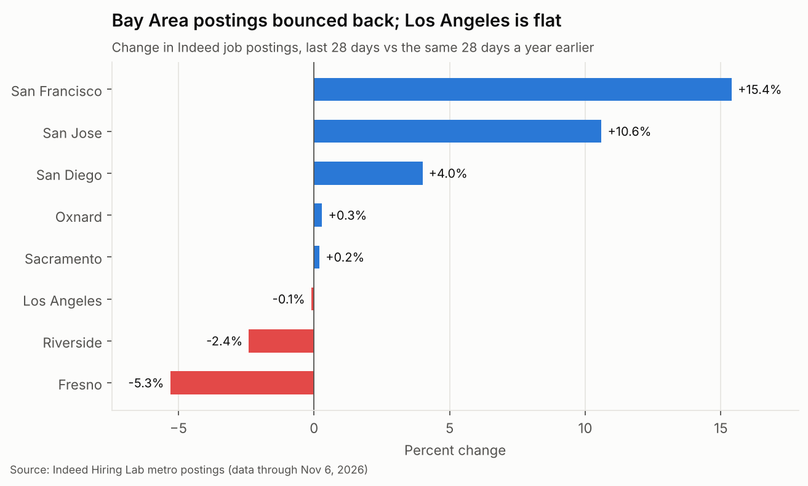
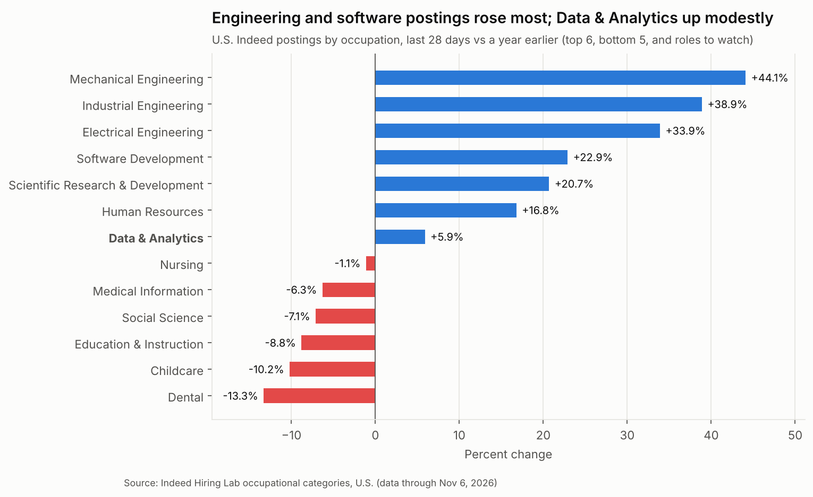

# Where California's Jobs Are Growing (2021–2026)

**Which industries in California are hiring, which are shrinking, and where should an entry-level data analyst in Los Angeles look?**

This project combines five years of official payroll data (U.S. Bureau of Labor Statistics) with daily job-posting data (Indeed Hiring Lab). Python cleans the files and loads them into SQLite. The analysis is written in SQL, and the results feed static charts and an interactive dashboard.

📊 **Interactive dashboard:** [`docs/index.html`](docs/index.html). After GitHub Pages is turned on, it is published at `https://resulisik.github.io/california-jobs-by-sector/`.

---

## Key findings

| | |
|---|---|
| **Health care carried the state** | Since Sep 2021, California added **+1.18M jobs (+7.0%)**. Health care & social assistance accounted for **+728K of them (61%)**. In the last 12 months the share rose to **81%** (105K of 129K). Education & health was above its year-earlier level in **every one of the last 24 months**. |
| **Tech and media are shrinking** | Information (tech, media, publishing) lost **−73K jobs (−12.5%)** and was below the year before in **22 of the last 24 months**. Within it, computer systems design fell **−9.0%** and motion picture & sound recording fell **−19.1%**. |
| **Losing streaks** | Construction, financial activities and manufacturing were below their year-earlier level in **all 24** of the last 24 months. |
| **Not fully recovered** | Seven of 11 sectors still have fewer jobs than in February 2020. Information is at **86%** of its pre-pandemic level and manufacturing at **93%**. |
| **Bright spots** | Aerospace product & parts grew **+25.7%** in five years. Leisure & hospitality added **+264K** jobs. |
| **Postings lag the nation** | Indeed postings in California are at **87** (Feb 2020 = 100), while the U.S. is at **104**. The gap has stayed between 17 and 19 points every year since 2023. |
| **Bay Area rebounding, LA flat** | Compared with a year ago, postings are up **+15.4%** in San Francisco and **+10.6%** in San Jose. Los Angeles is flat (**−0.1%**). |
| **Data roles** | U.S. postings for Data & Analytics rose **+5.9%** on the year. At an index of **63**, they are still far below 2020. Software development is **+22.9%** and engineering roles are up 34–44%. |

**What I take from it:** for an entry-level analyst in Los Angeles, the largest and steadiest employers are hospital systems, insurers and public agencies. Healthcare data (claims, patient flow, quality measures) is the domain worth building skills in. That is why my next project is a hospital emergency-department analysis.

## Charts







## Data

| Source | What | Frequency | Coverage |
|---|---|---|---|
| BLS Current Employment Statistics, via [FRED](https://fred.stlouisfed.org/) | Payroll jobs for California: total, 11 supersectors, 8 industries, and Los Angeles County | Monthly | Jan 2020 – Sep 2026 |
| [Indeed Hiring Lab](https://github.com/hiring-lab/job_postings_tracker) | Job postings index for California, the U.S., 30 California metros, and 47 occupations (U.S.) | Daily | Feb 2020 – Nov 6, 2026 |

All 21 BLS series are listed with their IDs in [`src/config.py`](src/config.py). Supersectors are seasonally adjusted. Four industry series are only published unadjusted, so they are compared September to September.

## How it works

```
download_data.py ──► data/raw/            FRED CSVs + Indeed CSVs
build_database.py ─► data/ca_jobs.db      5 tables: series, employment, postings_state, postings_metro, postings_occ
validate.py ───────► checks vs the EDD    12-month changes must match the state's published release
run_queries.py ────► sql/results.md       12 SQL questions
make_charts.py ────► charts/*.png
build_dashboard.py ► docs/index.html      self-contained interactive page (no external libraries)
```

## SQL analysis

[`sql/analysis_queries.sql`](sql/analysis_queries.sql) answers 12 questions. The output is in [`sql/results.md`](sql/results.md).

1. Five-year job change by sector, ranked
2. Last 12 months by sector
3. Recovery against February 2020
4. Each sector's share of all jobs, 2021 vs 2026
5. How much of the net growth came from health care
6. Industry spotlight (aerospace, motion pictures, computer systems design…)
7. Year-by-year change, September to September
8. Losing streaks: months below the same month a year earlier
9. Postings: California vs U.S., by year
10. Postings by large metro: now vs a year ago
11. Postings by occupation: top and bottom movers, plus data roles
12. Los Angeles County vs the state

**Techniques:** CTEs; window functions (`LAG` for year-over-year change, `RANK`, `ROW_NUMBER`); conditional aggregation with `CASE` to pivot months into columns; self-joins to a base month for indexing; date arithmetic for rolling 28-day windows.

## Validation

`python src/validate.py` checks that the 12-month change for all 11 sectors matches the California Employment Development Department's September 2026 release to the job (for example, education & health +125,600 and information −24,200). It also checks that every series has all 81 months with no gaps.

## Run it yourself

```bash
pip install -r requirements.txt
python src/download_data.py     # about 80 MB from FRED and GitHub
python src/build_database.py
python src/validate.py
python src/run_queries.py
python src/make_charts.py
python src/build_dashboard.py   # writes docs/index.html
```

The BLS raw files and monthly processed CSVs are committed, so the data can be explored without downloading anything. Rebuilding the database needs the download step.

## Limitations

- Payroll data counts jobs by the **employer's industry**, not by occupation. A data analyst at a hospital counts as a health care job.
- The Indeed index measures the **trend** in postings relative to Feb 1, 2020, not the number of open jobs. Occupation-level postings are published only for the U.S.
- BLS revises state data every March. Figures here are as published in October 2026.

## Project structure

```
├── charts/                 PNG charts used above
├── dashboard/template.html dashboard template (data is injected at build time)
├── data/
│   ├── raw/bls/            BLS series from FRED (committed)
│   ├── raw/indeed/         Indeed files (downloaded, not committed)
│   └── processed/          tidy CSV extracts (monthly)
├── docs/index.html         built dashboard (GitHub Pages)
├── sql/                    analysis queries and results
└── src/                    Python pipeline
```

---

**Resul Isik** · Data Analyst · Los Angeles, CA · [LinkedIn](https://www.linkedin.com/in/resul-isik/) · [GitHub](https://github.com/resulisik)
